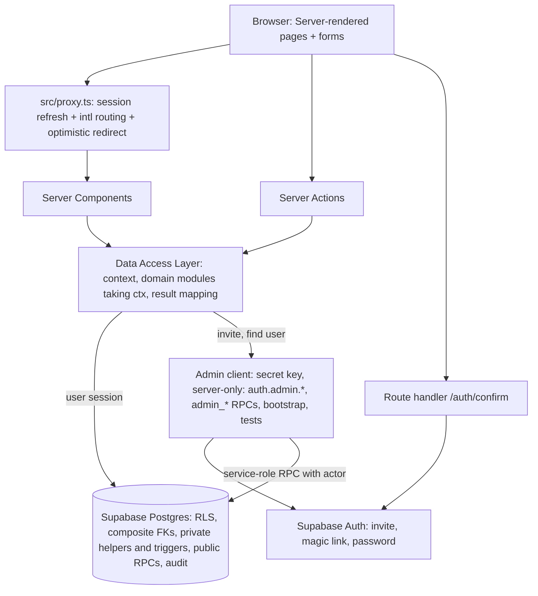
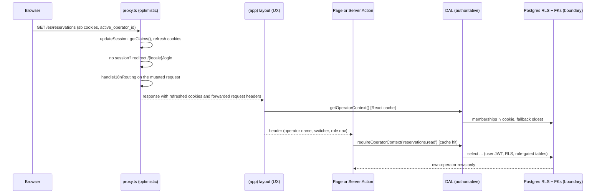
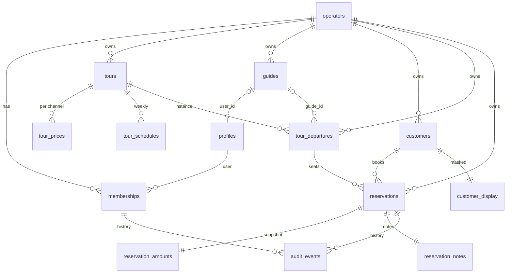
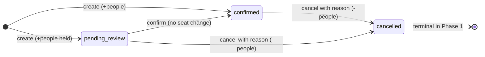
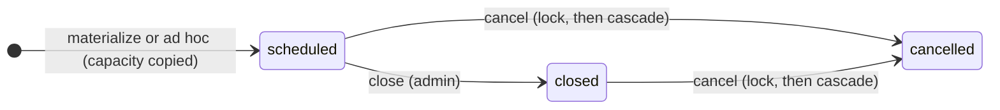

# Phase 1 Multi-Operator Foundation - Plan

**Target repo:** `cupo` (this repository, empty at plan time). Template to mirror as a pattern only: the sibling `go_pesca` repo (branch `develop`, snapshot 2026-11-10). Paths below are relative to the `cupo` repo root unless prefixed with `go_pesca/`.

---

## Goal Capsule

- **Objective.** Stand up the multi-operator foundation of cupo: a Next.js 16 + Supabase monorepo where operators, memberships with four roles, tours with capacity, guides, customers and manual reservations exist, every business row is isolated per operator by Row-Level Security plus composite foreign keys, and an automated cross-operator isolation suite passes locally and in CI.
- **Authority hierarchy.** Product behavior: the Requirements (R-IDs) in the Product Contract, which carry forward the origin architecture document (see origin). Implementation mechanism: the Key Technical Decisions (KTD-IDs). A unit never overrides either.
- **Execution profile.** Greenfield, one PR per implementation unit on a `feature/CP-{issue}-{slug}` branch, merged into `main`. Each unit is independently testable; units that ship migrations ship their database tests in the same PR.
- **Stop conditions.** Stop and surface instead of guessing when: a settled decision (KTD) cannot work as researched; a change would expose rows of one operator to a user of another; a requirement would need data from the missing functional requirements document (see Assumptions); an external prerequisite (Supabase projects, SMTP, Vercel) blocks a unit.
- **Tail ownership.** The implementer owns lint, typecheck, unit tests, the database suite, a Vercel preview per PR and the Definition of Done. The plan owner (Kevin) owns the external prerequisites in Risks & Dependencies and the GitHub Project tickets.

---

## Product Contract

### Summary

Build Phase 1 of cupo as a new monorepo that mirrors the Go Pesca template pattern: a Next.js 16 web app, separate Supabase projects, and a shared TypeScript package. The plan delivers operators and memberships with four roles, tours with schedules, prices and capacity-tracked departures, a guide registry with a simple guide-to-departure link, customers, manual reservations that enforce the last-seat rule in the database, invite-only authentication, an audit trail, and an automated isolation suite that is the phase's exit condition.

### Problem Frame

Tour operators run bookings from spreadsheets and inboxes. cupo will become one system shared by many operators, with later phases adding email ingestion of channel bookings, guide assignment, settlements and notifications. Those phases only work if the foundation gets three things right from the first commit: every row has an owning operator and the database enforces that boundary even when application code forgets; the operator is derived from the authenticated session and never from client input; and what cannot be undone (reservation changes, amounts, access) is recorded. The origin document states these as principles and fixes the stack. The template repo (Go Pesca) shows the stack working but is single-tenant, applies migrations by hand, and already hit the recursive-policy bug that a membership table invites. Phase 1 exists to build the boundary once, test it, and leave a migration workflow that cannot drift.

### Product Contract preservation

Carried forward from the origin architecture document without scope change. Two refinements agreed during planning are recorded as session-settled decisions: tour schedule times are stored as local date and time plus the operator's IANA zone instead of UTC instants (KTD7), and a simple guide link on departures is pulled into Phase 1 (KTD13). Money handling in Phase 1 (prices per channel and a role-gated amount snapshot per reservation) follows the origin data model (KTD14).

### Actors

- A1. **Administrador** — operator owner. Manages users, guides, tours, departures, reservations; sees amounts, customer data and the audit trail.
- A2. **Reservas** — booking staff. Creates and edits reservations and customers, creates ad hoc departures; never sees prices or amounts.
- A3. **Contabilidad** — accounting staff. Reads tours, departures, reservations, notes and amounts; sees customers masked; cannot create reservations or edit anything.
- A4. **Guía** — guide with an access link. Sees only departures assigned to them from now on, with masked customers and no amounts or notes.
- A5. **Platform owner** (Kevin) — runs the bootstrap script; no UI role in Phase 1.

### Requirements

**Multi-operator base (origin MUL-01, MUL-02, MUL-06; principles 1 and 2)**

- R1. One deployment serves every operator; there is no per-operator copy of the software or database.
- R2. Every business table carries `operator_id`, `created_at` and `updated_at`; the database enforces per-operator isolation with Row-Level Security on every table exposed to the Data API, and a row can only reference parent rows of its own operator.
- R3. A user belongs to operators through memberships of (user, operator, role) with exactly the roles administrador, reservas, guía, contabilidad; a user may belong to several operators with different roles.
- R4. The active operator for a request is resolved on the server from the session and the user's memberships; a client-supplied operator id is never used as authority, and `operator_id` cannot be changed after insert.
- R5. A user with no active membership lands on a "no access" page; a user whose active membership was removed falls back to another membership or that page on the next request.
- R6. An operator carries name, IANA timezone (validated), ISO 4217 currency and default locale `es`; an inactive operator grants no rows and no context.
- R7. A bootstrap script creates an operator plus its first administrador and is idempotent; local and CI environments are seeded with three operators for isolation tests.

**Access and roles (origin security section)**

- R8. Staff (administrador, reservas, contabilidad) sign in with email and password; guides sign in with a one-time access link; public signup is disabled and every account is created by invitation.
- R9. An invitation writes the membership in the same server action that creates or finds the auth user; inviting an email that already has an account adds the membership and sends a sign-in link without creating a second user; responses never reveal whether an email is registered.
- R10. Role permissions are enforced on the server in every server action and in the database for every write path, including direct Data API calls with a user's own session; hiding a control in the UI is not access control.
- R11. Prices and reservation amounts are readable only by administrador and contabilidad; customer name, email and phone are fully readable only by administrador and reservas; other roles get a masked display; reservation notes are readable by administrador, reservas and contabilidad only.
- R12. An operator always keeps at least one administrador; removing or demoting the last one is rejected.
- R13. A password reset flow exists for staff; an account created by invite or recovery cannot use the app until a password is set.
- R14. A user with two or more memberships can switch the active operator; the switch is validated server-side and the operator name is visible on every page; sign-out clears the session and the active-operator cookie.

**Catalog (origin DIS-01, GUI-01; entities Tour, Guía, Cupo)**

- R15. A tour has name, description, duration, default capacity, archived state and a price per channel in minor units plus currency; only the `direct` channel price is required in Phase 1.
- R16. A tour has weekly schedules (weekday, local start time, optional capacity override, validity window); a departure is a tour on a date and start time with its own capacity and booked-seat counter.
- R17. Departures are materialized from a schedule when the first reservation needs them, or created ad hoc by administrador or reservas; capacity is copied at creation and does not follow later tour edits; a cancelled departure's slot can be materialized again.
- R18. A departure can be closed (no new reservations) by administrador, or cancelled, which cancels its active reservations in one transaction; closed and cancelled are terminal in Phase 1 and no reservation can land on a cancelled departure.
- R19. A guide has name, contact, languages, specialties, max daily hours and active flag; a guide may be linked to a user account; a membership with role guía must map to exactly one guide of that operator.
- R20. A departure may name one guide; a guía user reads only departures where that guide is them and the start instant is in the future, and only non-cancelled reservations on those departures.
- R21. Archiving a tour hides it from pickers and rejects new departures and reservations; existing data is unchanged.

**Reservations and capacity (origin RES entity, ingestion rule 7)**

- R22. A manual reservation has a per-operator sequential code, channel `direct`, departure, customer, number of people, status, notes, cancel reason and an incomplete-data flag computed on the server; code, creator and flag cannot be set by the client.
- R23. Reservation statuses are `pending_review`, `confirmed` and `cancelled`; every status except `cancelled` holds seats; cancelling requires a reason; `cancelled` is terminal in Phase 1.
- R24. Any write that changes held seats adjusts the departure's booked-seat counter in the same transaction; two concurrent reservations cannot sell the last seat; a change that would exceed capacity fails and leaves every counter unchanged; the counter always equals the sum of people over non-cancelled reservations.
- R25. A reservation stores an amount snapshot (unit price, currency, total) taken from the tour's channel price at creation by the database; editing people recomputes the total unless administrador overrode the amount.
- R26. Customers are unique per operator by email when present; a customer with only a name is allowed and marks the reservation incomplete.
- R27. No authenticated role can hard-delete reservations, customers or departures in Phase 1.

**Audit (origin principle 4)**

- R28. Changes to reservations, reservation amounts and memberships are recorded with actor, action, old and new values and time, by the database, on every write path.
- R29. Administrador can read the change history of a reservation; no authenticated role can write or alter audit rows.

**Quality and exit condition (origin Phase 1 condition)**

- R30. An automated suite proves, for every business table, that a user of operator A cannot read, insert into, update, or reference rows of operator B, including a user who belongs to A and B; the suite runs locally and in GitHub Actions.
- R31. An automated check proves every table exposed to the Data API has RLS enabled, at least one policy and an explicit grant, and that every `security definer` function lives outside exposed schemas with a pinned search path.
- R32. The web app is bilingual-ready (`es` default, `en` scaffold) with message-key parity enforced by a test; UI copy ships in Spanish.

### Key Flows

- F1. **Bootstrap** — Trigger: platform owner runs the bootstrap script against the local stack or `cupo-dev`, or dispatches the protected workflow job for `cupo-prod`. Actors: A5. Steps: create operator; create or find the admin auth user; insert administrador membership through a service-role RPC that records the actor; Supabase emails the invite. Outcome: the admin sets a password and lands in the app. Covered by: R6, R7, R8.
- F2. **Invite and accept** — Trigger: administrador invites an email with a role, or sends access from a guide record. Actors: A1, invitee. Steps: server action checks permission; creates the user with an invite, or finds the existing user id without sending mail; inserts the membership under the administrador's own session; sends a sign-in link to existing users; the invitee lands on the confirm route; staff set a password, guides go straight in. Outcome: the invitee has a working session with the role in the active operator. Covered by: R8, R9, R13, R19.
- F3. **Manual reservation** — Trigger: reservas starts a new reservation. Actors: A2. Steps: pick tour, date, departure slot (schedule-derived or existing); set people; pick or create the customer; save through the reservation RPC; the database materializes the departure if needed, takes seats, snapshots the amount, assigns the code, computes the incomplete flag and writes the audit row. Outcome: a confirmed reservation with a code, or a typed error with nothing changed. Covered by: R17, R22 to R26, R28.
- F4. **Departure lifecycle** — Trigger: administrador closes or cancels a departure. Actors: A1. Steps: close blocks new reservations; cancel asks for confirmation showing active reservations, then marks the departure first and cancels its reservations in one transaction with one audit row each. Outcome: counters end consistent. Covered by: R18, R24, R28.
- F5. **Guide agenda** — Trigger: a guía opens the app. Actors: A4. Steps: context resolves the guide record; the agenda lists future departures assigned to them with reservations and masked customers. Outcome: the guide sees only their own work. Covered by: R11, R20.
- F6. **Switch operator** — Trigger: a multi-operator user picks another operator. Actors: any. Steps: server action validates the membership, writes the active-operator cookie, revalidates. Outcome: navigation and permissions follow the new role. Covered by: R4, R14.

### Acceptance Examples

- AE1. **Last seat.** Covers R24. Given a departure with capacity 10 and 9 seats booked, When 10 reservations of 1 person are created concurrently, Then exactly one succeeds, `seats_booked` is 10, and the sum of people over non-cancelled reservations equals 10.
- AE2. **Cross-operator read.** Covers R2, R30. Given users ua (member of A) and ub (member of B) and a tour of B, When ua selects tours through the Data API with their own session, Then the tour of B is absent and no error is returned.
- AE3. **Foreign insert.** Covers R2, R4, R30. Given user ua of A, When ua inserts a reservation whose `operator_id` is B, Then the insert fails with a policy violation and no row exists.
- AE4. **Amount privacy.** Covers R11. Given a reservas user, When they select from the reservation amounts or tour prices tables with their own session, Then zero rows are returned.
- AE5. **Masked customer.** Covers R11. Given a contabilidad user, When they read a reservation, Then the customer appears as first name plus last initial and no email or phone is readable.
- AE6. **Last administrador.** Covers R12. Given an operator with one administrador, When that membership is deleted or demoted, Then the statement fails and the membership is unchanged.
- AE7. **Removed membership.** Covers R5. Given a signed-in user whose only membership is deleted, When they make the next request, Then they are redirected to the no-access page and server actions throw a forbidden error.
- AE8. **Departure cancel.** Covers R18, R28. Given a departure with 3 active reservations, When administrador cancels it, Then all 3 are cancelled with reason `departure_cancelled`, `seats_booked` is 0, and 3 audit rows name the administrador as actor.
- AE9. **Existing email invite.** Covers R9. Given an email that already belongs to operator A, When administrador of B invites it, Then B gets a membership for the same user, no second auth user exists, a sign-in link is sent, and the action state is identical to a new-email invite.
- AE10. **Guide scope.** Covers R20. Given a guía linked to guide g with one future and one past departure assigned, When they list departures, Then only the future one is returned and departures of other guides are absent.
- AE11. **Foreign parent.** Covers R2, R30. Given user ua of A and a departure d of B, When ua inserts a reservation with `operator_id` A and `departure_id` d, Then the insert fails with a foreign-key violation and B's counter is unchanged.
- AE12. **Direct write obeys the rules.** Covers R10, R23. Given a reservas user and a cancelled reservation, When they update its status to `confirmed` directly through the Data API, Then the update fails with `forbidden_transition` and no seats move.

### Scope Boundaries

**In scope.** Everything in Requirements, for the web admin app only.

**Deferred for later (origin Phases 2 to 5).**

- Email ingestion, channels, Gmail OAuth, LLM extraction, `apps/worker` and the PostgreSQL job queue.
- Guide assignment table, agenda with hours, max-daily-hours enforcement, a guide-facing notes field.
- Reopening a closed departure and reactivating a cancelled reservation (both terminal in Phase 1).
- Production provisioning as a phase gate: creating `cupo-prod` in its own Supabase organization, SMTP on prod, the protected environment secrets and the pilot bootstrap are Phase 2 prerequisites; the workflow paths are defined in Phase 1 but not exercised against prod.
- Pay rules, settlements, payments, reports and exports.
- Customer confirmations, reminders, WhatsApp and Google Calendar.
- Capacity calendar view, capacity sync to channels, operator self-signup, subscriptions, second-language content.
- Reservation statuses `no_show` and `completed`; maps (Leaflet); PWA for guides.

**Deferred to Follow-Up Work (plan-local).**

- Two-factor authentication for administrador and contabilidad (Supabase MFA TOTP; restrictive `aal2` policies).
- A visual identity and `DESIGN.md`; Phase 1 ships neutral design tokens only.
- A custom access token hook embedding the active operator in the JWT, only if the per-request membership lookup shows up in profiling.
- Error monitoring vendor (Sentry or equivalent); Phase 1 ships a structured console logger and the monitoring checklist in Operational Notes.
- Audit retention window, to be defined before Phase 3 (settlements); Phase 1 keeps everything.
- A 6-digit OTP fallback for guides if mail scanners consume magic links in the pilot.
- Vitest component tests with jsdom; Phase 1 tests pure logic and the database.

**Outside this product's identity (origin "Fuera de alcance tecnológico").** Per-client software copies; Redis; Kubernetes; microservices; an ORM; Expo; GraphQL.

### Dependencies

- One hosted Supabase project for Phase 1, `cupo-dev` (previews and rehearsals), separate from Go Pesca, created by the plan owner before U2 merges. `cupo-prod` (pilot, separate organization) is a Phase 2 prerequisite.
- A Vercel project for `apps/web` created by the plan owner before U1's PR, with the settings in Operational Notes; the preview deploy is part of U1's verification.
- Custom SMTP (Resend or equivalent) configured on `cupo-dev` before any invite goes to a real address (and on `cupo-prod` in Phase 2); the hosted default sends two emails per hour to team members only.
- Docker on each developer machine for the local Supabase stack.
- GitHub CLI token with `project` scope for ticket creation (not needed for implementation).

### Outstanding Questions

- Deferred, non-blocking: SMTP provider (default Resend) and sender domain.
- Deferred, non-blocking: whether `main` stays the only long-lived branch (assumed) or a `develop` integration branch is added as in Go Pesca.

### Sources

- Origin: `docs/brainstorms/2026-11-10-arquitectura-sistema-tour-operador.md` (text extracted from the PDF beside it).
- Template: `go_pesca/apps/web/src/lib/supabase/*`, `go_pesca/apps/web/src/i18n/*`, `go_pesca/apps/web/src/app/globals.css`, `go_pesca/apps/web/eslint.config.mjs`, `go_pesca/apps/web/next.config.mjs`, `go_pesca/package.json` (root `optionalDependencies` block), `go_pesca/REVIEW.md`, migrations `011_groups.sql` and the lost `012_fix_groups_rls_recursion.sql` (recursion lesson).
- Next.js 16 docs shipped in the template: `go_pesca/apps/web/node_modules/next/dist/docs/01-app/` (`03-api-reference/03-file-conventions/proxy.md`, `02-guides/upgrading/version-16.md`, `02-guides/data-security.md`, `02-guides/server-actions.md`, `02-guides/authentication.md` "Layouts and auth checks", `01-getting-started/06-fetching-data.md` "Reusing data with React.cache").
- Supabase: Row-Level Security guide, RLS performance guide, Database functions, Column-level security, Testing RLS, Server-Side Auth for Next.js, Passwordless login, Auth admin `inviteUserByEmail` and `generateLink`, Local development and CLI config (`config push`), Testing overview (GitHub Actions), Postgres auditing blog, changelog "tables not exposed automatically" (2026).
- PostgreSQL: transaction isolation (Read Committed re-evaluation), trigger firing order (alphabetical by name), `on conflict` semantics.
- next-intl 4 App Router routing and middleware docs; Vitest 3.2 projects guide; Turborepo internal packages guide.

---

## Planning Contract

### Key Technical Decisions

- KTD1. **Supabase projects: local CLI stack for development and CI; two hosted projects.** `cupo-dev` serves Vercel previews, bootstrap rehearsals and the migration preflight; `cupo-prod` serves the pilot and holds real customer data. The Vercel Preview environment holds only dev keys; prod secrets exist only in the Vercel Production environment and a protected GitHub environment. `cupo-prod` lives in a separate Supabase organization: the access token used by the CI preflight and the dev deploy belongs to a CI account in the dev organization only (Supabase access tokens are account-wide, not project-scoped), and a second access token for prod exists only in the protected environment. Carries forward the origin default of a base separate from Go Pesca; a single hosted project was rejected because every PR preview would run unreviewed code with the secret key against pilot PII.
- KTD2. **Isolation by RLS plus composite foreign keys, through private helpers.** Governs R2, R3, R6, R30, R31. RLS is the visibility boundary; cross-operator references are blocked by the schema: every parent table has `unique (operator_id, id)` and every child declares `foreign key (operator_id, <parent>_id) references parent (operator_id, id)`; single-column FKs between business tables are not allowed. A `private` schema (not exposed to the Data API) holds `private.user_operator_ids()` (joins `operators`, excludes inactive ones), `private.has_role(operator_id, roles[])` and `private.my_guide_ids()` (returns `setof uuid`, one per operator where the user is a linked guide), all `security definer`, `stable`, `set search_path = ''`, executable by `authenticated`. Every policy is `to authenticated`, wraps helper and `auth.uid()` calls in `(select ...)`, and every business table has a btree index leading with `operator_id`. The `memberships` policies use `user_id = (select auth.uid())` or the helper, never a subquery on `memberships` (the recursion bug Go Pesca hit). Each table-creating migration includes `enable row level security` and explicit grants, because new Supabase projects no longer auto-grant table privileges. `private` holds only SQL-internal helpers called from policies, triggers and other functions; anything the app or tests call over the Data API lives in `public` as `security invoker`.
- KTD3. **Active operator resolved in a server-only Data Access Layer; domain modules take the context as a parameter.** Governs R4, R5, R14. `getOperatorContext()` (React `cache`, one query per render pass) reads the user via `getClaims()`, loads memberships, intersects with an `active_operator_id` cookie, falls back to the oldest membership by `created_at`, and returns `{ user, operator, role, guideId? }` or null. The cookie is `httpOnly`, `secure` outside development, `sameSite=lax`, `path=/`, value `<user_id>:<operator_id>`; a value whose user part differs from the session user is ignored and rewritten. `requireOperatorContext(action)` throws `ForbiddenError` or `UnauthenticatedError`. It is called in every page and every server action; the `(app)` layout call is UX only (layouts do not re-run on every navigation). Domain DAL modules receive `ctx` as their first parameter and never resolve context themselves. Server actions stamp `operator_id` from `ctx` only. A sign-out action clears the Supabase cookies and this cookie. A JWT custom-claims hook was rejected for Phase 1 because claims go stale until token refresh and the model needs several operators per user.
- KTD4. **Authorization = permission map in `packages/shared` + DAL checks + role-gated tables; no views, no exposed definer functions.** Governs R10, R11. `PERMISSIONS: Record<Role, readonly Action[]>` with a pure `can(role, action)` is unit-tested and used by both the DAL and the UI. Because the browser holds the same session as the server, DTO filtering alone is not a boundary: prices live in `tour_prices`, amounts in `reservation_amounts`, notes in `reservation_notes`, customer PII in `customers`, each with select policies restricted by `private.has_role`. A `customer_display (customer_id, operator_id, display_name)` table, maintained by a trigger on `customers` (first name plus last initial), is readable by every role of the operator; for roles without full customer access the DAL fetches reservations first and then `customer_display` for those customer ids in a second query, because PostgREST cannot embed it from `reservations` (no direct foreign key). `operator_id` is accepted on insert (the server action stamps it from `ctx` and each table's `with check` policy validates it through the helpers) and is excluded from the update grant so it cannot change after insert. Server-owned columns (`created_at`, `created_by`, `code`, `seats_booked`, `has_incomplete_data`, `starts_at`) are excluded from the insert and update column grants to `authenticated`; definer triggers populate them. Column grants for *select* privacy and `security_invoker` views were rejected (they cannot hide columns a role can already read through PostgREST).
- KTD5. **Invariants live in definer triggers; RPCs orchestrate; the DAL maps errors.** Governs R17, R18, R22 to R25. Responsibility table:

  | Layer | Owns | Never does |
  |---|---|---|
  | Policies | who may read or write which rows (operator, role) | business state checks |
  | Triggers on `reservations`, `tour_departures`, `customers`, `operators` (in `private`, `security definer`, `set search_path = ''`) | every invariant for every write path: seat delta and capacity, `departure_not_open`, `tour_archived`, `forbidden_transition` (`cancelled` is terminal for reservations and for departures; `closed` is terminal for departures in Phase 1), cancel reason required, `created_by` from `auth.uid()`, reservation code, `has_incomplete_data`, amount snapshot, `starts_at`, `customer_display`, audit | orchestration |
  | RPCs in `public` (`security invoker`): `create_reservation`, `update_reservation`, `cancel_departure` | one transaction: materialize departure, upsert customer, insert reservation plus notes, return `{id, code}`; input validation; a found-check on every targeted row | re-raising invariants the triggers own |
  | DAL `result.ts` | maps SQLSTATE and error name to action state; the only place that knows `42501`, `23505`, `23514`, `40P01`, `P0001` | business checks |

  Seat rule: `old_held = (old.status <> 'cancelled') * old.people` on `old.departure_id`, `new_held = (new.status <> 'cancelled') * new.people` on `new.departure_id` (insert: `old_held = 0`; delete: `new_held = 0`); same departure applies `new_held - old_held` with `update tour_departures set seats_booked = seats_booked + delta where id = ... and seats_booked + delta <= capacity returning status`, raising `capacity_exceeded` on zero rows; different departures release on the old and take on the new, locking the two rows in ascending id order. `departure_not_open` is raised only when held seats increase on a `cancelled` departure, or when inserting or moving into a `closed` one; releases never check status. `check (seats_booked between 0 and capacity)` named `tour_departures_seats_within_capacity` is the backstop. `cancel_departure` first sets the transaction-local setting `cupo.cancel_departure` to the departure id with `set_config(..., true)`, then does `update tour_departures set status = 'cancelled' where id = $1 and status <> 'cancelled' returning id` (lock plus transition), raising `forbidden_transition` on zero rows, then cancels active reservations; the `t20_departure_rules` trigger allows `scheduled -> closed` directly but accepts a transition to `cancelled` only when that setting names the row, so every cancellation runs the cascade. Typed errors are `raise exception using errcode = 'P0001', message = '<name>'` with names listed once in `packages/shared/src/errors.ts`. Read-then-check inside a trigger and serializable isolation with retries were rejected (the first is not atomic, the second does not compose with PostgREST transactions).
- KTD6. **Trigger-based audit in an exposed `audit` schema.** Governs R28, R29. `audit.events (id, operator_id, table_name, record_id, op, old_record, new_record, actor_id, actor_source, at)` written by one definer `after` trigger function with `set search_path = ''`, `actor_id = coalesce(auth.uid(), nullif(current_setting('app.actor_id', true), '')::uuid)`, `actor_source` in `jwt | app | system`, `operator_id` from `coalesce(new.operator_id, old.operator_id)`; `actor_id` has no foreign key so history survives user deletion. Attached to `reservations`, `reservation_amounts` and `memberships` in Phase 1; `customers` is excluded on purpose (PII erasure). `audit` is listed in the Data API schemas with `usage` granted to `authenticated`; `events` is readable by administrador of the same operator only; no insert, update or delete is granted. Server code using the secret key never writes business rows through the Data API; it calls `public.admin_*` RPCs, declared `security invoker` (the `service_role` grants bypass RLS, so no definer is needed) and executable by `service_role` only, that take `actor_id` as a parameter, set `app.actor_id` with `set_config(..., true)` and write in the same transaction (a `set_config` in one request and a write in the next are different PostgREST transactions). `public.profiles (id, email, full_name)` mirrors `auth.users` through a definer trigger; its select policy is own row, or the caller holds a staff role (administrador, reservas, contabilidad) in an operator the profile's user belongs to; a guía reads only their own profile.
- KTD7. **Time and money representation.** Governs R6, R15, R16, R25. Instants (`created_at`, `updated_at`, `audit.at`) are `timestamptz` in UTC. Tour schedules and departures store local `date` and `time` with the operator's IANA zone, and a derived `starts_at timestamptz` maintained by a `before` trigger on departures and recomputed for future departures by an `after update of timezone` trigger on `operators`. Money is `bigint` minor units with `check (>= 0)` plus `char(3)` currency checked against `^[A-Z]{3}$`; formatting happens only at the UI edge with `Intl.NumberFormat`; a small currency exponent map lives in `packages/shared`. (session-settled: user-approved — chosen over UTC-only storage for schedule times: a future "09:00 local" stored as a UTC instant drifts when DST or tzdata rules change.)
- KTD8. **Invite-only auth with token-hash confirm route.** Governs R8, R9, R13. Supabase config `enable_signup = false` globally; staff accounts are created with `auth.admin.inviteUserByEmail`; guide accounts are created with `auth.admin.createUser({ email_confirm: true })` (no invite mail) and only ever receive magic links; when the email already exists, the user id is looked up in `profiles` by `lower(email)` through the admin client (no link is minted; `generateLink` was rejected because it returns a live sign-in token for a user who may belong to another operator), the membership is inserted under the inviting administrador's own session (RLS and `auth.uid()` do the work), and `signInWithOtp({ shouldCreateUser: false })` sends the sign-in link. Email templates for invite, magic link and recovery use `{{ .RedirectTo }}/auth/confirm?token_hash={{ .TokenHash }}&type=...` so links from a preview land on that preview; the route handler lives outside `[locale]`, validates `type` against `invite | recovery | magiclink | email`, accepts `next` only when it matches `^/[A-Za-z0-9]` and is not an auth route, derives the destination from the verified type (invite and recovery go to set-password, others to `next` or home), and resolves the locale from `next`, then the `NEXT_LOCALE` cookie, then `es`. Staff accounts carry `app_metadata.password_set_at`; while it is null and the active context role is a staff role (administrador, reservas, contabilidad) the app redirects to set-password; a guía context is never redirected, and a user who is guía in one operator and staff in another is asked when a staff context becomes active. The set-password action calls `updateUser({ password })`, sets `password_set_at` with `auth.admin.updateUserById` through the admin client, then calls `refreshSession()` on the user's server client so the cookies carry the new claim before redirecting (the claim lives in the JWT and would otherwise stay stale until the next refresh). `otp_expiry` is 900 seconds. The PKCE `?code=` callback used by Go Pesca was rejected because invites do not support PKCE and mail scanners consume `ConfirmationURL` links.
- KTD9. **Next.js 16 conventions.** Governs R10. `src/proxy.ts` with `export async function proxy` (Node runtime): `updateSession(request)` runs first and calls `getClaims()` immediately after creating the client; if it redirects (no session on an `(app)` path, locale taken from the first path segment with `hasLocale`, default `es`), that response is returned with the refreshed cookies; otherwise next-intl's `handleI18nRouting(request)` runs on the same mutated request, and cookies are copied with `setAll` (keeping options) together with the `cache-control`, `expires` and `pragma` headers. The matcher excludes `api`, `_next`, `_vercel`, `auth/confirm` and files with an extension. Proxy forwards an `x-pathname` request header for layouts that need the current section. Proxy does optimistic redirects only. Mutations are server actions with `useActionState` and Zod-validated plain objects (the action converts `FormData` first); reads happen in Server Components through the DAL; server actions are public POST endpoints, so every id is validated as a uuid and a found-check follows every targeted write. `cacheComponents` stays off; ESLint uses `eslint-config-next` flat presets plus `no-restricted-imports` for `next/link` and `next/navigation`; Turbopack is the default build with `turbopack.root` set to the repo root; `next.config.mjs` (not `.ts`) to keep `@swc/core` out of the build path, as the template learned.
- KTD10. **Migrations through the Supabase CLI, forward-only, types generated and checked.** Governs R2, R7, R31. `supabase/migrations/<timestamp>_<name>.sql` created with `supabase migration new`; `supabase db reset` rebuilds local and CI databases from zero; functions use `create or replace` with unchanged signatures; schema fixes ship as new migrations; a branch whose migration is older than one already on `main` rebases and regenerates its timestamp before merge. Every migration is compatible with the app version currently deployed (expand/contract), so the order in which Vercel and `db push` finish does not matter. `db-deploy.yml` pushes to `cupo-dev` on every merge to `main` under a `concurrency` group that never cancels an in-progress push, and to `cupo-prod` through `workflow_dispatch` on a protected GitHub environment with a required reviewer; it dumps the target database before pushing and uploads it as a workflow artifact (7-day retention), encrypted with `age` to a public key stored in the protected environment when the target is prod (the private key stays with the plan owner outside GitHub; the dev dump may stay unencrypted); it never passes `--include-seed`. Production app deploys are not automatic: `apps/web/vercel.json` disables production deployments from `main` (`git.deploymentEnabled.main = false`, previews unchanged) and the prod job runs `vercel deploy --prod` with a `VERCEL_TOKEN` secret only after `db push` to `cupo-prod` succeeds, so a new app never runs against an old schema. The same protected workflow offers a `bootstrap-operator` job that runs the bootstrap script against prod with the prod secret key held only there. Before the pilot has real data, `cupo-prod` may be rebuilt from migrations; after that, never. `supabase/seed.sql` seeds operators and catalog rows and aborts unless the server address is loopback or the Docker range; auth users are created after `db reset` by `scripts/seed-users.ts` through the admin API (direct inserts into `auth.users` leave no `auth.identities` row and break password login) with random passwords printed by the harness. `npm run db:types` regenerates `packages/shared/src/database.types.ts` for schemas `public` and `audit`; CI fails if the committed file differs. Hand-numbered migrations applied through the SQL editor (Go Pesca) were rejected because they let the repo and the live database drift.
- KTD11. **Test layout and CI.** Governs R30, R31, R32. One root `vitest.config.ts` with `test.projects`: `unit` (pure logic in `apps/web/src/**` and `packages/shared/src/**`) and `db` (`tests/db/**`, `fileParallelism: false`, env mapped once in `tests/db/setup.ts` from `supabase status -o env` to the app variable names). pgTAP files in `supabase/tests/` run with `supabase test db`. GitHub Actions `ci.yml`: a `check` job (lint, typecheck, unit, build, secret-not-bundled grep) and a `db` job that always runs and reports (path detection inside the job skips the expensive steps, never a workflow-level `paths` filter, so the required check is always present), using `supabase/setup-cli@v3` with a pinned CLI version, `supabase start -x studio,storage-api,realtime,edge-runtime,logflare,vector,imgproxy`, one retry after `supabase stop --no-backup` on start failure, `timeout-minutes` 10 and 15, npm cache from the root lockfile; on pull requests it also runs the migration preflight against `cupo-dev` (`supabase migration list` and `supabase db push --dry-run` must show exactly the PR's new files pending). Branch protection on `main`: pull request required, checks `check`, `db` and the Vercel preview required, branches up to date, linear history. The basejump test-helpers dependency was rejected in favor of a native `set local role` pattern.
- KTD12. **i18n with URL locale prefixes, as in the template; one root layout.** Governs R32. `src/i18n/{routing,request,navigation}.ts` with `es` default and `en`; `src/app/[locale]/layout.tsx` is the root layout and renders `<html lang={locale}>` (there is no `src/app/layout.tsx`); `src/app/[locale]/[...rest]/page.tsx` returns a localized 404; the confirm route lives outside the locale segment; a unit test asserts key parity between `messages/es.json` and `messages/en.json`; server actions receive the locale explicitly for `getTranslations`.
- KTD13. **Single optional guide link on departures.** Governs R19, R20. `tour_departures.guide_id` nullable, set by administrador on the departure form; the guía select policy on departures filters by `guide_id in (select private.my_guide_ids())` and `starts_at >= now()`, and the guía policy on `reservations` filters by those departures and `status <> 'cancelled'`. (session-settled: user-approved — chosen over deferring guide visibility to Phase 2: a nullable column makes the guía policies writable and testable now and is forward-compatible with the Phase 2 assignments table.)
- KTD14. **Money handled in Phase 1.** Governs R11, R15, R25. `tour_prices (operator_id, tour_id, channel, price_minor, currency)` and `reservation_amounts (reservation_id, operator_id, unit_price_minor, currency, total_minor, amount_overridden)` ship in Phase 1; the amount row is written by a definer `after insert` trigger on `reservations` (reservas cannot read prices, so no invoker code can compute it) and recomputed on `people` changes unless overridden. (session-settled: user-approved — chosen over leaving all money to Phase 3: the origin data model puts prices on tours and the security section requires amounts hidden from reservas.)
- KTD15. **Package and branch conventions.** Workspaces `apps/web` (`@cupo/web`) and `packages/shared` (`@cupo/shared`, consumed as TypeScript source with `exports` pointing at `src`, no build step, `type: module`). `packages/shared` must not import `next/*`, `next-intl`, `react`, `server-only`, Supabase clients, `process.env`, cookies, headers or `FormData`; enforced with `no-restricted-imports` and a `tsconfig` whose `lib` has no `dom`. It holds `permissions.ts` (`Role` derived from the generated `membership_role` enum), `errors.ts`, `money.ts`, `schemas/*` (Zod 4 on plain objects with message keys, translated in the action) and `dto/*`. Branches `feature/CP-{issue}-{slug}`; one PR per unit into `main`; commit scopes `web`, `db`, `shared`, `ci`.

### Assumptions

- The functional requirements document (codes RES, DIS, GUI, AGE, PAG, FIN, CLI, MUL) was not available. The Phase 1 codes are interpreted as: MUL-01 operator entity, MUL-02 users and roles per operator, MUL-06 data isolation, DIS-01 capacity per tour and departure, GUI-01 guide registry. If the document surfaces, map R-IDs to its codes and adjust only where it contradicts a requirement above.
- A `pending_review` reservation holds seats (so Phase 2 ingestion cannot oversell).
- Cancelling a departure cascades to its reservations rather than blocking while reservations exist.
- A cancelled departure's slot may be sold again: the uniqueness of (tour, date, start time) is a partial index over non-cancelled departures.
- Route segment names are English (`reservations`, `tours`, `departures`, `guides`, `customers`, `members`, `agenda`); UI copy is Spanish.

### High-Level Technical Design

**Component topology.** Browser talks only to the Next.js app; the app talks to Supabase with the user's session (RLS on) or, in narrow server-only places, with the secret key through service-role RPCs.



**Request lifecycle.** Which layer is optimistic and which is authoritative.



**Data model.** `operator_id` on every business table; composite FKs; money, notes and PII split into role-gated tables.



**Reservation and departure lifecycles.**





**Create-reservation data flow.** One RPC, one transaction, triggers own the rules.

```mermaid
sequenceDiagram
  participant UI as Form (useActionState)
  participant SA as Server Action
  participant DAL
  participant DB as Postgres (RLS on)
  UI->>SA: plain object from FormData
  SA->>DAL: requireOperatorContext('reservations.write')
  DAL-->>SA: ctx {operator, role}
  SA->>SA: validate with Zod, stamp operator_id from ctx
  SA->>DB: rpc create_reservation(...)
  DB->>DB: materialize departure (partial-unique on conflict, select on conflict)
  DB->>DB: upsert customer; insert reservation and notes (found-check)
  DB->>DB: before triggers: state rules, seat delta with lock, incomplete flag, code (last)
  DB->>DB: after triggers: amount snapshot, audit
  DB-->>SA: {id, code} or P0001 '<name>'
  SA-->>UI: state {ok, code} or {error: '<name>'}
```

**Invite and confirm.** New and existing email.

```mermaid
sequenceDiagram
  participant A as Administrador (form)
  participant SA as invite action
  participant ADM as Admin client (secret key)
  participant AU as Supabase Auth
  participant DB as memberships (admin session, RLS, audit)
  participant I as Invitee
  participant C as /auth/confirm
  A->>SA: email, role
  SA->>SA: requireOperatorContext('members.invite')
  SA->>ADM: inviteUserByEmail(email, redirectTo)
  alt new email
    ADM->>AU: create user and send invite ({{ .TokenHash }})
  else email_exists
    SA->>ADM: profiles lookup by email returns user id, no link minted
  end
  SA->>DB: insert membership (operator from ctx, actor = admin via auth.uid())
  alt existing user
    SA->>AU: signInWithOtp(shouldCreateUser:false) sends link
  end
  SA-->>A: ok | duplicate | forbidden (same state for new and existing email)
  I->>C: GET ?token_hash&type=invite|magiclink&next=/es/...
  C->>AU: verifyOtp sets session cookies
  C-->>I: invite or recovery to /{locale}/set-password; magiclink to /{locale}/agenda
```

### Sequencing

U1 → U2 → U3 → {U4, U5, U9} → U6 → {U7, U10} → U8. U5's migration references `guides` (guide link), so the U5 branch rebases on `main` after U4 merges and regenerates its migration timestamp before merge; U9 is independent of U4 and U5. U6 depends on U5 and U9. U8 closes the phase.

### Output Structure

```text
cupo/
  package.json                      # workspaces, scripts, engines, root optionalDependencies (linux binaries)
  tsconfig.base.json
  vitest.config.ts                  # projects: unit, db
  .nvmrc  .gitignore  README.md  AGENTS.md  CLAUDE.md  REVIEW.md
  .github/workflows/ci.yml          # check job + db job (with preflight on PRs)
  .github/workflows/db-deploy.yml   # dev on main; prod on workflow_dispatch (protected environment)
  supabase/
    config.toml                     # auth settings, api schemas public+audit, templates
    templates/{invite,magic_link,recovery}.html
    seed.sql                        # operators and catalog; local-only guard
    migrations/<timestamp>_*.sql
    tests/*_test.sql                # pgTAP
  tests/db/                         # Vitest "db" project: isolation, roles, concurrency
    setup.ts  helpers.ts  *.test.ts
  scripts/{bootstrap-operator,seed-users}.ts
  packages/shared/
    package.json  tsconfig.json  eslint.config.mjs
    src/index.ts  src/permissions.ts  src/errors.ts  src/money.ts
    src/database.types.ts (generated)  src/schemas/*.ts  src/dto/*.ts
  apps/web/
    package.json  next.config.mjs  vercel.json  eslint.config.mjs  postcss.config.mjs  tsconfig.json
    .env.local.example
    messages/es.json  messages/en.json
    src/proxy.ts
    src/i18n/{routing,request,navigation}.ts
    src/lib/supabase/{client,server,proxy,admin}.ts
    src/lib/dal/{context,errors,members,guides,tours,departures,customers,reservations,audit,agenda}.ts
    src/lib/{logger,result}.ts
    src/app/globals.css
    src/app/auth/confirm/route.ts
    src/app/[locale]/layout.tsx                  # root layout, <html lang>
    src/app/[locale]/[...rest]/page.tsx          # localized 404
    src/app/[locale]/(auth)/{login,set-password,reset-password,no-access}/
    src/app/[locale]/(app)/layout.tsx           # context for header; role nav; UX redirects
    src/app/[locale]/(app)/{members,guides,tours,departures,customers,reservations,agenda}/
    src/components/{ui,layout,forms,reservations}/
```

---

## Implementation Units

### U1. Monorepo scaffold, tooling and CI

- **Goal:** A buildable, lint-clean, deployable monorepo with the stack fixed by the origin, mirroring the template's layout without its traps.
- **Requirements:** R1, R32 (scaffold); KTD9, KTD11, KTD12, KTD15.
- **Dependencies:** none (Vercel project is an external prerequisite).
- **Files:** `package.json`, `tsconfig.base.json`, `vitest.config.ts`, `.nvmrc`, `.gitignore` (exists), `README.md`, `AGENTS.md`, `CLAUDE.md`, `REVIEW.md`, `.github/workflows/ci.yml` (check job), `packages/shared/{package.json,tsconfig.json,eslint.config.mjs,src/index.ts}`, `apps/web/{package.json,next.config.mjs,vercel.json,eslint.config.mjs,postcss.config.mjs,tsconfig.json,.env.local.example}`, `apps/web/src/app/globals.css`, `apps/web/src/app/[locale]/{layout.tsx,page.tsx}`, `apps/web/src/app/[locale]/[...rest]/page.tsx`, `apps/web/src/i18n/*`, `apps/web/messages/{es,en}.json`, `apps/web/src/lib/logger.ts`, tests `apps/web/src/i18n/messages.test.ts`.
- **Approach:**
  1. Root: npm workspaces `apps/*`, `packages/*`; scripts `dev`, `build`, `lint`, `typecheck`, `test:unit`, `test:db`, `db:types`, `db:seed-users`; copy the template's root `optionalDependencies` block for linux swc, oxide and lightningcss binaries; `@parcel/watcher` as a direct dependency of `apps/web`; Node 22 pinned in root `engines.node`, `.nvmrc` and `actions/setup-node` (the Vercel project setting is the fourth place, see Operational Notes).
  2. `apps/web`: Next 16.3 with Turbopack default, `next.config.mjs` wrapping `createNextIntlPlugin` with `turbopack.root` at the repo root; ESLint flat config from `eslint-config-next/core-web-vitals` and `/typescript` plus `no-restricted-imports` for `next/link` and `next/navigation`; Tailwind v4 via `@tailwindcss/postcss` with a neutral token set in `globals.css` using the template's structure (`:root` raw tokens, `@theme inline` mapping, dark overrides) but new values.
  3. `packages/shared` per KTD15 with its own ESLint config enforcing the import rule; Zod 4 as a dependency; `typecheck` script.
  4. i18n per KTD12: the `[locale]` layout is the root layout; catch-all 404; parity test over the two message files.
  5. `logger.ts`: structured JSON logger with level, request id and operator id fields, console transport.
  6. CI `check` job: `npm ci`, lint, typecheck (web and shared), `vitest --project unit`, `next build`, then a grep of `apps/web/.next` for the `sb_secret_` prefix that must return nothing.
  7. Docs: `README.md` (setup, scripts, migration workflow, Vercel project name and team), `REVIEW.md` extended with multi-tenant rules (operator id never from the client; money, notes and PII gated by role; server versus client Supabase imports; shared package import rule), `AGENTS.md` with the Next-generated block committed.
- **Execution note:** Verification is smoke-first: a Vercel preview deploy of the landing page on this PR proves the lockfile and workspace setup before any feature work.
- **Patterns to follow:** `go_pesca/package.json`, `go_pesca/tsconfig.base.json`, `go_pesca/apps/web/eslint.config.mjs` (keep its `settings.next.rootDir`), `go_pesca/apps/web/next.config.mjs`, `go_pesca/apps/web/src/i18n/*`, `go_pesca/apps/web/src/app/globals.css` token structure, `go_pesca/REVIEW.md`.
- **Test scenarios:**
  - `messages/es.json` and `messages/en.json` have identical key sets (parity test fails when a key is added to one file only).
  - Test expectation for the rest: none -- scaffolding and configuration; proven by lint, typecheck, build, the secret grep and the preview deploy.
- **Verification:** `npm run lint`, `npm run typecheck`, `npm run test:unit` and `npm run build` pass locally and in the CI `check` job; the first-preview smoke checklist in Operational Notes passes and its build log is attached to the PR; `engines`, `.nvmrc`, the CI Node version and the Vercel Node setting agree; a fresh clone needs only `npm ci` and one `next dev` run before `tsc --noEmit` passes.

### U2. Database foundation, local stack and test harness

- **Goal:** Operators, profiles, memberships, the RLS helper functions, the audit infrastructure, the migration template, the seed and deploy workflow, generated types, and the database test harness that every later unit extends.
- **Requirements:** R2, R3, R6, R7, R12, R28, R29, R31; KTD1, KTD2, KTD6, KTD7, KTD10, KTD11.
- **Dependencies:** U1; `cupo-dev` hosted project with its GitHub values (access token, db password, project ref) before merge.
- **Files:** `supabase/config.toml`, `supabase/migrations/<ts>_foundation.sql` (schemas `private` and `audit`, enum `membership_role`, `operators`, `profiles`, `memberships`, helpers, `set_updated_at`, audit function, last-administrador trigger, `admin_bootstrap_operator` RPC), `supabase/seed.sql`, `supabase/tests/rls_coverage_test.sql`, `scripts/{bootstrap-operator,seed-users}.ts`, `packages/shared/src/database.types.ts`, `tests/db/{setup.ts,helpers.ts,foundation.test.ts}`, `.github/workflows/ci.yml` (db job), `.github/workflows/db-deploy.yml`.
- **Approach:**
  1. `supabase init`; `config.toml` with `[api] schemas = ["public", "audit"]`, `[auth] enable_signup = false`, `[auth.email] enable_signup = true`, `otp_expiry = 900`, `site_url`, `additional_redirect_urls` (localhost and one preview pattern scoped to this Vercel project), email templates under `supabase/templates/` per KTD8, password policy, rate limits; secrets through `env(...)`; defaults target `cupo-dev` and a `[remotes.production]` block overrides `project_id`, `site_url` and `additional_redirect_urls` for `cupo-prod`.
  2. Migration template written in the banner of the foundation migration and copied by every later migration: table columns `operator_id uuid not null`, `created_at` and `updated_at timestamptz not null default now()`, `unique (operator_id, id)` on parents, composite FKs on children (KTD2), `enable row level security`, explicit `grant select` and column-listed `grant insert`/`grant update` to `authenticated` that omit server-owned columns and grant `operator_id` on insert but not on update (KTD4), explicit `grant select, insert, update, delete` to `service_role`, index leading with `operator_id`, and for every function created in `public` a `revoke execute ... from public, anon, authenticated` right after creation followed by the explicit grant (to `authenticated` for the invoker RPCs, to `service_role` for `admin_*`), trigger naming `t10_set_updated_at`, `t20_<domain rule>` (before), `t80_<derived>` and `t90_audit` (after), update triggers with `when (old.* is distinct from new.*)`. `on delete` table: `profiles.id` and `memberships.user_id` cascade from `auth.users`; `guides.user_id` set null; `tour_prices` and `tour_schedules` cascade from tours; `tour_departures.tour_id`, `reservations.departure_id`, `reservations.customer_id` restrict; `tour_departures.guide_id` set null; `reservation_amounts` and `reservation_notes` cascade from reservations; `operators` restrict everywhere.
  3. `operators` (name, slug unique, timezone checked against `pg_timezone_names`, currency, locale, status) with select for members through the helper, update for administrador of that operator limited to the columns `name, timezone, locale`, no insert or delete for `authenticated`, and `status`, `slug` and `currency` changed only through `admin_*` RPCs; `profiles` mirrored from `auth.users` by a definer trigger with the select policy from KTD6; `memberships` (user_id, operator_id, role, primary key on the pair, index on `user_id`) with policies that never subquery `memberships`: select is own rows or `private.has_role(operator_id, '{administrador}')`, and administrador may insert, update and delete within their operator; `private.user_operator_ids()` and `private.has_role()` per KTD2 (`private.my_guide_ids()` ships with the guides migration in U4, which creates the table it reads); `audit.events` and `private.record_change()` per KTD6 attached to `memberships`; trigger rejecting delete or demote of the last administrador (`last_administrador`); `public.admin_bootstrap_operator(...)` executable by `service_role` only, taking `actor_id`.
  4. `seed.sql`: operators A, B and C plus a local-only guard; `scripts/seed-users.ts`: creates auth users for every role of A, one user in A and B, one in B, through the admin API with random passwords written to `tests/db/.seed-users.json` (gitignored); staff users are created with `app_metadata.password_set_at` set, the guía user without it; memberships go through an `admin_seed_membership` RPC (service-role only, same actor rule as the bootstrap RPC).
  5. `scripts/bootstrap-operator.ts`: idempotent on slug and admin email, calls `auth.admin.inviteUserByEmail` and `admin_bootstrap_operator` with the actor; prints only the operator id; `--print-link` exists for the local stack only and refuses a non-local URL; from a developer machine the script refuses any hosted URL, and hosted runs happen only through the `bootstrap-operator` workflow job (dev or the protected prod environment).
  6. Test harness: `tests/db/helpers.ts` creates per-user clients with the publishable key, an admin client with the secret key, helpers `expectZeroRows`, `expectSqlState(code)`, `expectTypedError(name)`, `reconcileSeats()` (zero drift rows over every departure touched); `setup.ts` maps `supabase status -o env` to the app variable names.
  7. pgTAP `rls_coverage_test.sql`: every table in `public` and `audit` has RLS, at least one policy and a grant to `authenticated`; no `security definer` function exists in `public` or `audit`; every function in `private` pins `search_path`; no function in `public` is executable by `anon`, and no `admin_*` function is executable by `authenticated`.
  8. CI `db` job per KTD11 including the preflight on PRs; `db-deploy.yml` per KTD10.
- **Execution note:** Write the cross-operator tests for `operators` and `memberships` first and watch them fail against a temporary `using (true)` policy, so the harness is proven able to fail.
- **Patterns to follow:** Supabase official helper-function recipe (KTD2 text); template SQL style (`go_pesca/apps/web/supabase/migrations/001_initial_schema.sql`: lowercase, section banners, sentence-named policies) but not its schema patterns.
- **Test scenarios:**
  - Covers AE2. An administrador of A selecting `operators` and `memberships` sees only A's rows; a reservas user of A sees A in `operators` and only their own membership row; a user who is administrador of A and B sees A and B but not C.
  - A user of A inserting a membership for operator B fails with a policy violation; a user of A and B updating `operator_id` of an A membership fails with a column privilege error.
  - An administrador updating `operators.timezone` succeeds; updating `status` or `currency` fails with a column privilege error; a reservas user updating `operators.name` affects zero rows.
  - `authenticated` calling `admin_bootstrap_operator` or `admin_seed_membership` with a user session fails with a privilege error; `anon` cannot execute any function in `public`.
  - Covers AE6. Deleting or demoting the last administrador of A fails with `last_administrador`; demoting one of two administradores succeeds.
  - A membership of an inactive operator yields zero rows from `private.user_operator_ids()` and from `operators`.
  - `operators` insert with timezone `America/Nowhere` fails; `America/Costa_Rica` succeeds.
  - A staff user of A selecting `profiles` sees members of A and themself, zero rows of B; a guía of A sees only their own row; `insert` into `profiles` as `authenticated` fails.
  - A seeded staff user signs in with a password and is not redirected to set-password; the seeded guía has no `password_set_at`.
  - Inserting a membership under an administrador session writes one `audit.events` row with `actor_id` equal to that user and `actor_source = 'jwt'`; the bootstrap RPC with an actor records that actor with source `app`; seeded memberships from `db reset` show source `system` and null actor.
  - A reservas user selecting `audit.events` gets zero rows; an administrador of A sees only A's rows; any `insert` into `audit.events` as `authenticated` fails.
  - A seeded user can `signInWithPassword` (proves `auth.identities` exist).
  - Deleting a seeded non-admin auth user removes its membership and profile and writes an audit row with source `system`.
  - Bootstrap script run twice against the local stack leaves one operator and one membership; run against a non-local URL with `--print-link` it exits non-zero without writing.
  - Seed guard: `seed.sql` run against a non-local address aborts before any insert.
  - pgTAP coverage test fails when a table is created without a policy or grant (verify once with a throwaway table in a rolled-back transaction).
- **Verification:** `supabase db reset` plus `npm run db:seed-users` rebuilds local and CI databases from zero; `supabase test db` and `vitest --project db` pass locally and in the CI `db` job; `npm run db:types` produces no diff after commit; on merge to `main` the `db-deploy` workflow is green against `cupo-dev`, `supabase migration list` shows the foundation migration applied, the dump artifact exists on the run, and `supabase config push --dry-run` reports no pending changes.

### U3. Authentication, session context, authorization layer and app shell

- **Goal:** Invite-only sign-in for staff and guides, the proxy, the Data Access Layer context, the permission map, the operator switcher, sign-out and role-aware navigation.
- **Requirements:** R4, R5, R8, R10, R13, R14; KTD3, KTD4, KTD8, KTD9, KTD12.
- **Dependencies:** U2.
- **Files:** `apps/web/src/proxy.ts`, `apps/web/src/lib/supabase/{client,server,proxy,admin}.ts`, `apps/web/src/app/auth/confirm/route.ts`, `apps/web/src/app/[locale]/(auth)/{login,set-password,reset-password,no-access}/page.tsx` and `actions.ts`, `apps/web/src/app/[locale]/(app)/layout.tsx`, `apps/web/src/components/layout/{header,operator-switcher,nav}.tsx`, `apps/web/src/lib/dal/{context,errors}.ts`, `apps/web/src/lib/result.ts`, `packages/shared/src/{permissions,errors}.ts`, `packages/shared/src/schemas/auth.ts`, tests `packages/shared/src/permissions.test.ts`, `apps/web/src/lib/dal/context.test.ts`, `apps/web/src/lib/result.test.ts`, `apps/web/src/proxy.test.ts`, `tests/db/auth.test.ts`.
- **Approach:**
  1. Supabase clients per KTD9 and the framework research shapes: browser, server (cookies `getAll`/`setAll` with try/catch), proxy (`updateSession` calling `getClaims()` immediately), admin (`server-only`, secret key, no session persistence, used only for `auth.admin.*` and `admin_*` RPCs).
  2. `proxy.ts` per KTD9: Supabase first on the mutated request, next-intl second, cookies with options and cache headers copied; `/auth/confirm`, `(auth)` pages and the no-access page are allowlisted to avoid redirect loops.
  3. `/auth/confirm` route handler per KTD8: `verifyOtp({ token_hash, type })`, validated `type` and `next`, destination derived from the verified type, locale fallback chain.
  4. Login page: one email field with two actions, "Entrar con contraseña" (`signInWithPassword`) and "Enviar enlace de acceso" (`signInWithOtp`, `shouldCreateUser: false`); magic link and reset always answer "Si el correo existe, enviamos un enlace", and the Supabase error for an unknown email is swallowed inside the action and never logged with the email. Set-password action per KTD8 (`updateUser`, `auth.admin.updateUserById` for `password_set_at`, `refreshSession`, redirect); reset flow uses `resetPasswordForEmail` with the recovery template.
  5. DAL context per KTD3; `result.ts` maps `UnauthenticatedError`, `ForbiddenError`, `NotFoundError`, SQLSTATE `42501`, `23505`, `23514`, `40P01` (retry state) and `P0001` by message to action state, using the names in `packages/shared/src/errors.ts`; `PERMISSIONS` map per KTD4 with actions such as `members.invite`, `members.write`, `guides.write`, `tours.write`, `departures.write`, `departures.ad_hoc`, `reservations.read`, `reservations.write`, `amounts.read`, `amounts.write`, `customers.read_full`, `customers.write`, `audit.read`, `agenda.read`.
  6. `(app)` layout calls `getOperatorContext()`; null routes to no-access; a staff-role context with `password_set_at` null routes to set-password (a guía context never does); the header shows the operator name always and the switcher when memberships are two or more; `nav.tsx` renders sections by `can(role, action)` (guía sees only Agenda); the switch and sign-out server actions per KTD3.
- **Execution note:** Implement the DAL context, the permission map and the result mapper test-first; they are pure logic with a mocked membership list and fake errors.
- **Patterns to follow:** `go_pesca/apps/web/src/lib/supabase/*` (cookie adapters), Next docs `02-guides/data-security.md` (DAL, DTOs), Supabase "Server-Side Auth for Next.js" (proxy, `getClaims`).
- **Test scenarios:**
  - `can('reservas', 'amounts.read')` is false; `can('contabilidad', 'amounts.read')` is true; `can('guia', 'reservations.write')` is false; `can('guia', 'agenda.read')` is true; every action in the map is granted to administrador.
  - Context: memberships [A, B] and cookie B yields operator B; cookie C (not a member) yields the oldest membership and marks the cookie for rewrite; cookie whose user part is another user is ignored; no memberships yields null; a guía membership yields `guideId`; memberships [B newer, A older] fall back to A.
  - Covers AE7. Removing the only membership of a signed-in seeded user makes `getOperatorContext()` return null and `requireOperatorContext` throw `ForbiddenError`.
  - Proxy (via `next/experimental/testing/server`): `/es/reservations` without session redirects to `/es/login`; `/en/reservations` redirects to `/en/login`; `/auth/confirm?token_hash=x` and `/es/no-access` are not redirected; after a refresh the forwarded request headers carry the new cookie, not only the response `set-cookie`.
  - Confirm route: missing `token_hash` redirects to login with an error; `next` values `https://evil.example`, `//evil.example`, `/\evil.example` and `/auth/confirm` are all replaced by home; `type=magiclink` with an invite token still lands on set-password because the destination comes from the verified type; an unknown `type` is rejected.
  - Result mapper: a `P0001` error with message `capacity_exceeded` maps to that state; `23514` naming `tour_departures_seats_within_capacity` maps to the capacity-below-booked state; `40P01` maps to a retry state.
  - db: `signInWithPassword` for a seeded staff user succeeds and a subsequent select on `operators` returns their operator; the magic-link action for an unknown email returns the same state as for a known email and creates no user; an invited staff user without a password requesting `/es/reservations` is redirected to set-password; after set-password the next request to `/es/reservations` is not redirected; a context with role guía and `password_set_at` null is not redirected.
  - Operator switch to a non-member operator returns a forbidden state and leaves the cookie unchanged; sign-out leaves no `active_operator_id` cookie.
- **Verification:** A seeded administrador logs in locally with a password and sees the app shell with their operator name and full navigation; a seeded reservas user sees only reservas navigation; a seeded guía requests a magic link, opens it from the local mail UI (port 54324) and lands on the agenda; a user with two memberships switches operators and the header changes; unit, proxy and db tests pass in CI; the preview deploy logs in against `cupo-dev`.

### U4. Members and guides management

- **Goal:** Administrador invites staff and guides, manages roles and access, and maintains the guide registry.
- **Requirements:** R9, R12, R19; KTD4, KTD6, KTD8.
- **Dependencies:** U3.
- **Files:** `supabase/migrations/<ts>_guides.sql` (`guides`, `private.my_guide_ids()`, guía-to-guide trigger, policies), `apps/web/src/lib/dal/{members,guides}.ts`, `apps/web/src/app/[locale]/(app)/members/{page.tsx,actions.ts}`, `apps/web/src/app/[locale]/(app)/guides/{page.tsx,[guideId]/page.tsx,actions.ts}`, `apps/web/src/components/forms/{invite-member-form,guide-form}.tsx`, `packages/shared/src/schemas/{members,guides}.ts`, tests `tests/db/members.test.ts`, `tests/db/guides.test.ts`.
- **Approach:**
  1. `guides` table per the migration template: name, email, phone, languages `text[]`, specialties `text[]`, max_daily_hours `smallint check 1..24`, active, user_id nullable (`on delete set null`), unique (operator_id, user_id), unique (operator_id, lower(email)) where email not null. Policies: administrador read and write; reservas and contabilidad read; guía reads own row.
  2. Trigger on `memberships` (`guide_not_linked`): a row with role guía must match a `guides` row of the same operator with `user_id` equal to the member.
  3. Invite staff action (`members.invite`) per KTD8 and the invite diagram: on `email_exists`, the user id comes from `profiles` by `lower(email)` through the admin client (no link minted); insert the membership under the administrador's session; on any email failure delete the membership created in this action; the action state is the same for new and existing emails and for every email failure; an existing membership returns the duplicate state.
  4. Guide access action from the guide record: requires guide email; finds the user in `profiles` or creates it with `auth.admin.createUser({ email_confirm: true })` (no invite mail), sets `guides.user_id`, inserts the guía membership, sends the magic link with `signInWithOtp`.
  5. Change role, remove membership, resend invite actions; deactivate guide sets `active = false` and deletes the membership in the same action (clearing `guide_id` on future departures is a trigger on `guides.active` shipped by U5's migration).
  6. Members page lists memberships joined with `profiles`; guides pages list and edit.
- **Patterns to follow:** U3 action and DAL shapes; `go_pesca/apps/web/src/components/auth/login-form.tsx` for form markup only.
- **Test scenarios:**
  - Covers AE9. Inviting an email already registered to operator A from operator B adds B's membership, creates no second auth user, sends one sign-in link (visible in the local mail UI), and the action state equals the new-email case; the invite action never receives or logs an `action_link` or `hashed_token`.
  - Sending access to a guide creates the auth user without an invite mail (only the magic link arrives) and a guía session lands on the agenda, never on set-password.
  - Inviting an email already a member of the same operator returns the duplicate state and leaves one membership.
  - Covers AE6 (action layer). Demoting the last administrador through the action returns the `last_administrador` state.
  - A reservas user calling the invite action gets a forbidden state and no membership is created; a reservas user inserting into `memberships` directly fails with a policy violation.
  - Inserting a guía membership for a user with no matching `guides.user_id` fails with `guide_not_linked`; after linking the guide it succeeds.
  - A guía user selecting `guides` sees only their own row; an administrador of A sees A's guides only; a user of B sees none of A's.
  - Guide email uniqueness: two active guides of A with the same email in different case fail; the same email in operator B succeeds.
  - Deactivating a guide removes their membership and their next request yields no context.
  - Membership insert and delete through actions each produce one audit row with the administrador as actor.
- **Verification:** On the local stack, an administrador invites a reservas user, the invite email appears in the local mail UI, the invitee sets a password and sees only reservas navigation; a guide is created, given access, and logs in with the link; db tests pass in CI.

### U5. Tours, prices, schedules and departures

- **Goal:** The catalog an operator sells: tours with per-channel prices, weekly schedules, and departures with capacity, status and an optional guide.
- **Requirements:** R15, R16, R17, R18, R20, R21; KTD5 (departure side), KTD7, KTD13, KTD14.
- **Dependencies:** U3; U4's migration must be on `main` before this unit's migration is timestamped.
- **Files:** `supabase/migrations/<ts>_tours.sql` (`channel` enum, `departure_status` enum, `tours`, `tour_prices`, `tour_schedules`, `tour_departures`, `private.set_departure_starts_at`, `private.recompute_starts_at_on_timezone`, `private.materialize_departure`, `private.clear_guide_on_deactivate`, `public.cancel_departure` status-only), `apps/web/src/lib/dal/{tours,departures}.ts`, `apps/web/src/app/[locale]/(app)/tours/{page.tsx,new/page.tsx,[tourId]/page.tsx,actions.ts}`, `apps/web/src/app/[locale]/(app)/departures/{page.tsx,[departureId]/page.tsx,actions.ts}`, `apps/web/src/components/forms/{tour-form,price-form,schedule-form,departure-form}.tsx`, `packages/shared/src/schemas/tours.ts`, `packages/shared/src/money.ts`, tests `packages/shared/src/money.test.ts`, `apps/web/src/lib/dal/departures.test.ts` (slot derivation), `tests/db/tours.test.ts`, `tests/db/departures.test.ts`.
- **Approach:**
  1. `tours` (name, description, duration_minutes, default_capacity `check (>= 1)`, meeting_point text, archived_at); `tour_prices` (operator_id, tour_id, channel, price_minor, currency; unique tour+channel) readable by administrador and contabilidad only, writable by administrador; `tour_schedules` (operator_id, tour_id, weekday 0..6, start_time, capacity_override, valid_from, valid_to with `check (valid_to is null or valid_to >= valid_from)`; unique tour+weekday+start_time); `tour_departures` (operator_id, tour_id, date, start_time, capacity `check (>= 1)`, seats_booked default 0, status, guide_id, origin `schedule | ad_hoc` set at creation and never updated, `starts_at`; partial unique index on (tour_id, date, start_time) where status <> 'cancelled'; check `tour_departures_seats_within_capacity`). Composite FKs per KTD2. Update grant to `authenticated` lists `capacity, status, guide_id, date, start_time` only; the `t20_departure_rules` trigger accepts `status = 'cancelled'` only from `cancel_departure` (KTD5), so a direct cancellation without the cascade is impossible.
  2. `starts_at` per KTD7: `before insert or update of date, start_time` trigger on departures reads `operators.timezone`; `after update of timezone on operators ... when (old.timezone is distinct from new.timezone)` rewrites future departures only.
  3. Policies: tours, schedules and departures readable by all roles of the operator except guía, who reads departures via KTD13; writes by administrador; reservas may insert departures (ad hoc) under `departures.ad_hoc`. A `before insert` trigger raises `tour_archived` for archived tours; a `before update` trigger enforces the departure state machine (`forbidden_transition` out of `cancelled`).
  4. `private.materialize_departure(tour_id, date, start_time)` (definer, SQL-internal, used by U6's RPCs): inserts with `on conflict ... where status <> 'cancelled' do nothing returning id`, and when nothing is returned selects the existing non-cancelled id; capacity is `coalesce(schedule.capacity_override, tours.default_capacity)` with origin `schedule` when a schedule matches weekday, start time and validity, else origin `ad_hoc` with the tour default. The ad hoc action inserts directly under the departure insert policy.
  5. `public.cancel_departure(departure_id uuid)` (invoker) per KTD5, status-only in this unit; U6 does `create or replace` with the identical signature to add the cascade.
  6. Trigger `private.clear_guide_on_deactivate`: `after update of active on guides` clears `guide_id` on that guide's future departures.
  7. DAL `listDepartureSlots(ctx, tourId, date)`: union of schedule-derived slots and existing non-cancelled rows, with available seats; a pure function with unit tests.
  8. `money.ts`: minor-unit formatting with currency exponent map and `Intl.NumberFormat`; parsing from form input to minor units.
- **Patterns to follow:** U2 migration template; U3 action shapes.
- **Test scenarios:**
  - Unit: `formatMinor(12500, 'USD', 'es-CR')` renders the expected string; `parseToMinor('125.50', 'USD')` is 12550; JPY has exponent 0; slot derivation for a Tuesday lists the Tuesday schedules within validity plus existing departures, deduplicated by start time, excluding cancelled rows.
  - Covers AE2 for tours, prices, schedules and departures (user of B sees none of A's).
  - Covers AE11 (catalog). Administrador of A inserting a departure with `tour_id` of B, or setting `guide_id` to a guide of B, fails with a foreign-key violation.
  - Covers AE4 (prices). A reservas user selecting `tour_prices` gets zero rows; contabilidad gets rows.
  - Inserting a departure with `seats_booked` 5 directly fails with a column privilege error; lowering capacity below `seats_booked` fails with `23514` naming `tour_departures_seats_within_capacity` and the action state reads "Hay N lugares vendidos".
  - Two concurrent materializations of the same slot return the same id; materializing a time that matches no schedule yields origin `ad_hoc` and the tour default capacity; after a departure is cancelled, materializing the same slot creates a new row.
  - A departure's `starts_at` equals the expected UTC instant for `America/Costa_Rica`; a timezone change on an operator with one future and one past departure rewrites exactly one `starts_at`; an unrelated operators update touches none.
  - Close a departure; a direct update back to `scheduled` fails with `forbidden_transition`; cancel from closed succeeds; cancel on a departure with no reservations succeeds; a direct update of `status` to `cancelled` through the Data API fails with `forbidden_transition`; any transition out of cancelled fails with `forbidden_transition`.
  - Covers AE10. A guía linked to guide g lists only future departures with `guide_id` g.
  - Deactivating guide g clears `guide_id` on g's future departures and leaves past ones.
  - Archived tour: a direct departure insert fails with `tour_archived`.
- **Verification:** An administrador creates a tour with a direct price and two schedules, sees derived slots for next week, creates an ad hoc departure, assigns a guide, closes it; a reservas user sees the tour without prices; db tests pass in CI.

### U9. Customers

- **Goal:** Customer records with per-operator uniqueness, full visibility for administrador and reservas, and a masked display for everyone else.
- **Requirements:** R11 (customers), R26; KTD2, KTD4.
- **Dependencies:** U3 (parallel with U4 and U5).
- **Files:** `supabase/migrations/<ts>_customers.sql` (`customers`, `customer_display`, `private.sync_customer_display`), `apps/web/src/lib/dal/customers.ts`, `apps/web/src/app/[locale]/(app)/customers/{page.tsx,actions.ts}`, `apps/web/src/components/forms/customer-form.tsx`, `packages/shared/src/schemas/customers.ts`, tests `tests/db/customers.test.ts`.
- **Approach:**
  1. `customers` (name, email, phone, preferred_locale; unique operator + lower(email) where not null) with select, insert and update for administrador and reservas only; no delete grant.
  2. `customer_display (customer_id primary key, operator_id, display_name)` with composite FK, maintained by an `after insert or update of name` definer trigger on `customers` (first name plus last initial), selectable by every role of the operator, no write grants.
  3. DAL with search by name, email or phone; customers list and inline create for the reservation form (consumed by U6).
- **Patterns to follow:** U2 template; U4 DAL and page shapes.
- **Test scenarios:**
  - Covers AE2 for customers and `customer_display`.
  - Covers AE5 (customers half). Contabilidad and guía selecting `customers` get zero rows; selecting `customer_display` returns the masked name.
  - Inserting `Ana@x.com` when `ana@x.com` exists in the same operator fails; the same email in another operator succeeds.
  - Renaming a customer updates `display_name`; `customer_display` rejects a direct insert or update from `authenticated`.
  - A reservas user attempting `delete` on customers affects zero rows (re-read as admin).
- **Verification:** A reservas user creates and searches customers; contabilidad sees masked names only; db tests pass in CI.

### U6. Reservations core: schema, capacity, amounts, notes and the booking flow

- **Goal:** Manual reservations that consume capacity atomically through definer triggers, with amount snapshots, notes, codes, the incomplete-data flag and audit on every write path.
- **Requirements:** R11 (amounts, notes), R22 to R25, R27, R28; KTD4, KTD5, KTD6, KTD14.
- **Dependencies:** U5, U9.
- **Files:** `supabase/migrations/<ts>_reservations.sql` (`reservation_status` enum, `reservations`, `reservation_notes`, `reservation_amounts`, `private.reservation_counters` and `private.next_reservation_code`, triggers `t20_reservation_rules`, `t25_reservation_seats`, `t27_reservation_flag`, `t30_reservation_code`, `t80_reservation_amount`, `t90_audit`, `t85_customer_flag` on `customers`, `public.create_reservation`, `public.update_reservation`, `public.cancel_departure` replaced with the cascade, `public.admin_seat_drift()`, `public.admin_reconcile_seats(actor_id)`), `apps/web/src/lib/dal/reservations.ts`, `apps/web/src/app/[locale]/(app)/reservations/{page.tsx,new/page.tsx,actions.ts}`, `apps/web/src/components/forms/{reservation-form,customer-picker}.tsx`, `packages/shared/src/schemas/reservations.ts`, tests `tests/db/reservations.test.ts`, `tests/db/capacity.test.ts`.
- **Approach:**
  1. `reservations` (code, channel, external_code nullable with unique (operator, channel, external_code), departure_id not null, customer_id not null, people `check (> 0)`, status, has_incomplete_data not null, cancel_reason with `check (status <> 'cancelled' or cancel_reason is not null)`, created_by `references profiles on delete set null`, unique (operator_id, code)); composite FKs to departures and customers; select for administrador, reservas, contabilidad, and for guía per KTD13; insert and update for administrador and reservas with column-listed grants per KTD4; no delete grant.
  2. `reservation_notes (reservation_id primary key, operator_id, notes)` select for administrador, reservas and contabilidad, write for administrador and reservas; `reservation_amounts` per KTD14 with select for administrador and contabilidad, update (the override) for administrador only, and no insert grant to `authenticated`.
  3. Triggers per KTD5 and the naming convention: `t20_reservation_rules` (state machine with `cancelled` terminal, `departure_not_open`, `tour_archived`, `created_by`, rejects insert with status cancelled, rejects moving to a departure of another tour), `t25_reservation_seats` (seat rule with locks), `t27_reservation_flag` (before insert or update of `customer_id`: sets `has_incomplete_data` from the customer's email and phone, so the not-null column is filled before the row lands and audit sees the final value), `t30_reservation_code` (calls `private.next_reservation_code` last, after capacity, so rejected creates leave no gap), `t80_reservation_amount` (snapshot from `tour_prices`, `price_missing` if absent; recompute on `people` unless overridden), `t90_audit`; `t85_customer_flag` (after update of email, phone on `customers`) updates only reservations whose flag would change.
  4. RPCs per KTD5: `create_reservation` (materialize, upsert customer, insert reservation and notes, return `{id, code}`), `update_reservation` (people, departure move with materialization, notes), `cancel_departure` replaced with the cascade. Every RPC starts with `private.has_role` on the target operator and found-checks every targeted row (`not_found`).
  5. `public.admin_seat_drift()` (read-only, rows where `seats_booked` differs from the held sum) and `public.admin_reconcile_seats(actor_id)` (locks and rewrites, audited through `app.actor_id`), both `security invoker` and executable by `service_role` only per KTD6, so the admin client can call them on hosted projects; the db test helper `reconcileSeats()` and the `db-deploy` post-push check call `admin_seat_drift` through the admin client.
  6. UI: reservations list (filters by date and status) and the new-reservation form with tour → date → slot → people → customer picker (search, inline create) → notes → status.
- **Execution note:** Write the concurrency test (AE1), the cancel-under-load test and the shared reconciliation helper before the trigger bodies; they are the acceptance tests for this unit.
- **Patterns to follow:** PostgreSQL conditional-update pattern (KTD5 text); Supabase audit blog shape (KTD6); U5 DAL and action shapes.
- **Test scenarios:**
  - Covers AE1. Capacity 10, 9 booked, 10 concurrent creates via `Promise.allSettled`: one success, nine `capacity_exceeded`, `seats_booked` 10, `reconcileSeats()` clean.
  - Create on a schedule slot with no departure row materializes exactly one departure and books seats on it.
  - Cancel with a reason releases seats; cancel without a reason fails the check; any status change on a cancelled reservation, by any role, fails with `forbidden_transition` and moves no seats.
  - Covers AE12. Reservas updating a cancelled row to `confirmed` directly through the Data API fails with `forbidden_transition`; a direct insert by reservas (not through the RPC) still gets a code, an amount row and the flag.
  - Moving a reservation of 2 people to a departure with 1 seat left fails and both counters are unchanged; moving to one with 2 seats left succeeds and both counters move; moving to a departure of another tour fails with `forbidden_transition`.
  - One update that cancels and moves in the same statement releases seats on the old departure and takes none on the new; two concurrent opposite moves both complete or one returns the retry state, never an unmapped error.
  - Changing people from 2 to 4 on a departure with 1 seat left fails; from 4 to 2 succeeds; on a `closed` departure a people increase within capacity succeeds.
  - Create on a closed or cancelled departure fails with `departure_not_open`; on an archived tour with `tour_archived`.
  - Covers AE8. Cancel a departure with 3 active reservations: all cancelled with reason `departure_cancelled`, seats 0, three audit rows with the administrador as actor and source `jwt`; cancel a departure while 10 concurrent creates target it: every reservation is cancelled or failed with `departure_not_open`, seats 0, reconciliation clean.
  - Delete under the admin client releases seats and reconciliation holds.
  - Codes of 10 concurrent creates in one operator are distinct consecutive values; a failed create does not consume a code; two operators start at `D-000001`; a client-supplied `code` is rejected by the column grant.
  - `has_incomplete_data` is true for a customer with neither email nor phone, false after adding a phone, and a client update of the column fails on the grant; adding a phone to a customer with two reservations writes exactly two audit rows.
  - Covers AE4 (amounts). Reservas selecting `reservation_amounts` gets zero rows; the row exists when read by contabilidad with `total_minor` equal to people times the direct price; a tour without a direct price fails creation with `price_missing`.
  - Editing people from 2 to 3 recomputes `total_minor` unless `amount_overridden` is true.
  - Covers AE11. Reservas of A inserting a reservation with `operator_id` A and a departure or customer of B fails with a foreign-key violation and B's counter is unchanged.
  - Covers AE5 (reservation read). Contabilidad reading a reservation gets the masked display through `customer_display` and zero rows from `customers`; guía gets zero rows from `reservation_notes` and `reservation_amounts`.
  - A reservas user attempting `delete` on reservations and departures affects zero rows (re-read as admin).
  - `admin_seat_drift()` returns zero rows after the suite; after the admin client corrupts one counter, `admin_reconcile_seats(actor_id)` restores zero rows and writes an audit row with the given actor; `authenticated` calling either gets a privilege error.
  - Contabilidad updating `reservation_notes` or `reservation_amounts` affects zero rows; administrador updating `reservation_amounts.total_minor` succeeds and sets `amount_overridden`.
- **Verification:** On the local stack a reservas user books the last seats of a departure, a second attempt shows the capacity error, cancel with a reason releases them; contabilidad sees amounts and masked customers; the `db` job's post-suite reconciliation gate is clean; db tests pass in CI.

### U10. Reservation detail and change history

- **Goal:** The reservation detail page with edit and cancel, and the audit history view for administrador.
- **Requirements:** R23, R29; KTD6.
- **Dependencies:** U6.
- **Files:** `apps/web/src/app/[locale]/(app)/reservations/[reservationId]/page.tsx`, `apps/web/src/app/[locale]/(app)/reservations/actions.ts` (edit, cancel), `apps/web/src/lib/dal/audit.ts`, `apps/web/src/components/reservations/history.tsx`, tests `apps/web/src/lib/dal/audit.test.ts`, `tests/db/history.test.ts`.
- **Approach:**
  1. Detail page shows the reservation, customer (full or masked by role), notes (by role), amount (by role), actions by `can(role, action)`.
  2. Cancel requires a reason; a cancelled reservation is read-only; edit calls `update_reservation`.
  3. History DAL reads `audit.events` for the reservation and its amount row, resolves `departure_id` and `customer_id` to labels, resolves `actor_id` through `profiles` ("Usuario eliminado" when missing, "Sistema" for source `system`), and renders changed keys only.
- **Patterns to follow:** U6 action shapes; U3 result mapper.
- **Test scenarios:**
  - Unit: the diff renders only changed keys, resolves ids to labels, and shows "Sistema" for system rows and "Usuario eliminado" for a missing profile.
  - db: administrador of A reads the history of an A reservation; reservas gets zero rows from `audit.events`; administrador of B gets zero rows for A's reservation.
  - Action: cancel without a reason returns the validation state; editing a cancelled reservation returns the forbidden-transition state.
- **Verification:** Administrador opens a reservation, edits people, cancels with a reason, and sees the three changes in the history with actor and timestamps in the operator timezone.

### U7. Guide agenda

- **Goal:** The guía experience: a future-only agenda of assigned departures with reservations and masked customers, nothing else.
- **Requirements:** R11, R20; KTD4, KTD13.
- **Dependencies:** U6.
- **Files:** `apps/web/src/app/[locale]/(app)/agenda/page.tsx`, `apps/web/src/lib/dal/agenda.ts`, tests `tests/db/guide-visibility.test.ts`, `apps/web/src/lib/dal/agenda.test.ts`.
- **Approach:**
  1. Agenda DAL reads departures (RLS already restricts to the guide's future ones), then reservations, then `customer_display` for those customer ids in a second query (KTD4); groups by date in the operator timezone.
  2. The `(app)` layout reads the `x-pathname` header forwarded by the proxy (KTD9) and redirects a guía whose first section segment is not `agenda` (UX); every other page calls `requireOperatorContext` so a guía hitting `/es/reservations` by URL gets the forbidden state.
- **Patterns to follow:** U6 DAL and page shapes.
- **Test scenarios:**
  - Covers AE10 through the Data API: a guía selecting `tour_departures`, `reservations`, `reservation_notes`, `customers`, `customer_display`, `reservation_amounts`, `tour_prices`, `audit.events`, `memberships` and `profiles` with their own session gets, respectively, only their future departures; only non-cancelled reservations on them; zero rows; zero rows; masked names for those reservations; zero rows; zero rows; zero rows; only their own membership row; only their own profile row.
  - A guía with no assigned departures gets an empty agenda and no error.
  - Unit: grouping by date uses the operator timezone (a 23:30 UTC start on a Costa Rica operator lands on the previous local day).
- **Verification:** A seeded guía logs in with a magic link, sees only the agenda with two future departures and masked customer names, and gets the forbidden state on any other page; db tests pass in CI.

### U8. Cross-operator isolation matrix and phase exit

- **Goal:** Prove the Phase 1 exit condition with one matrix suite covering every business table, role and RPC, and leave the repo ready for Phase 2.
- **Requirements:** R30, R31, R32; KTD11.
- **Dependencies:** U7, U10.
- **Files:** `tests/db/isolation-matrix.test.ts`, `tests/db/role-matrix.test.ts`, `supabase/tests/rls_coverage_test.sql` (extended), `README.md` (test, migration and runbook sections), `docs/solutions/` entries.
- **Approach:**
  1. Table-driven matrix: for each business table (`operators`, `memberships`, `profiles`, `guides`, `tours`, `tour_prices`, `tour_schedules`, `tour_departures`, `customers`, `customer_display`, `reservations`, `reservation_notes`, `reservation_amounts`, `audit.events`) and each actor (user of A; user of A and B; administrador of A), assert: select returns only own operators' rows; insert with a foreign `operator_id` fails; insert with own `operator_id` and a foreign parent id fails with a foreign-key violation; update targeting a foreign row affects zero rows (re-read as admin); delete targeting a foreign row affects zero rows; a guard compares `information_schema.tables` for `public` and `audit` with the matrix list. `operators` and `profiles` carry no `operator_id` and enter the matrix with their own assertions instead of the `operator_id` ones: operators are visible only through memberships and `authenticated` cannot insert or delete them nor update columns outside `name, timezone, locale`; profiles follow the KTD6 policy and `authenticated` cannot insert them.
  2. Role matrix: for each role of operator A, assert the visibility rules of R11 against the Data API, and for every RPC × role cell assert forbidden roles get `forbidden` (never success or an empty update); a user of A calling `cancel_departure` or `update_reservation` with an id of B gets `not_found` and B's rows are unchanged.
  3. Fail-ability check documented as a README runbook step (temporary `using (true)` policy makes the matrix fail), not committed.
  4. pgTAP extended: definer functions enumerated by name (policy helpers, audit, seat, code, amount, flag, display, profile mirror, starts_at, recompute, materialize, reconcile); any addition fails the test.
  5. `docs/solutions/`: the RLS helper and composite-FK pattern, the trigger-ownership rule, the migration workflow and the isolation harness.
- **Patterns to follow:** U2 harness helpers.
- **Test scenarios:**
  - Covers AE2, AE3, AE11, R30. Every table-by-actor cell in the matrix passes; adding a table to `public` or `audit` without adding it to the matrix list fails the guard test.
  - Covers R31. pgTAP coverage passes; a function in `public` or `audit` declared `security definer` fails; a new definer function in `private` not in the enumerated list fails.
  - Covers R32. Message parity test still passes with the full Phase 1 message set.
- **Verification:** The CI `db` job runs the full matrix green on the PR; the Definition of Done checklist below is met; a tag `phase-1` is created on `main`. Provisioning `cupo-prod` and bootstrapping the pilot are Phase 2 prerequisites, not part of this unit.

---

## Verification Contract

| Gate | Command | Applies to | Pass signal |
|---|---|---|---|
| Lint | `npm run lint` | all units | ESLint exits 0 for `apps/web` and `packages/shared` (including the shared import rule) |
| Typecheck | `npm run typecheck` | all units | `tsc --noEmit` exits 0 in `apps/web` and `packages/shared` |
| Unit tests | `npm run test:unit` (`vitest --project unit`) | U1, U3, U5, U6, U7, U10 | all unit suites green |
| Build | `npm run build` | all units | `next build` with Turbopack exits 0 |
| Secret not bundled | grep of `apps/web/.next` for `sb_secret_` | U1 onward | no hits |
| Database rebuild | `supabase db reset` then `npm run db:seed-users` | U2 onward | migrations, seed and users apply from zero without error |
| pgTAP | `supabase test db` | U2 onward | RLS coverage, grant and function hygiene assertions pass |
| Database suite | `npm run test:db` (`vitest --project db`) | U2 onward | isolation, role, capacity and audit tests green |
| Seat invariant | `admin_seat_drift()` through the admin client after the suite | U6 onward | zero rows |
| Generated types | `npm run db:types -- --check` | U2 onward | no diff in `packages/shared/src/database.types.ts` |
| Migration preflight | `supabase migration list` and `supabase db push --dry-run` against `cupo-dev` (PRs) | U2 onward | pending set equals exactly the PR's new migration files |
| Hosted auth config | `supabase config push --dry-run` against `cupo-dev` | U2 onward | no pending changes |
| Preview deploy | Vercel preview on the PR | all units | preview renders; from U3, login works against `cupo-dev` |
| CI | `.github/workflows/ci.yml` | all units | `check`, `db` and the Vercel preview status green; wall time under 15 minutes |

Behavioral gates with thresholds: AE1 must show exactly one success out of ten concurrent attempts, every run; the isolation matrix must cover every table listed in `information_schema.tables` for schemas `public` and `audit`.

---

## Definition of Done

**Global**

- Every requirement R1 to R32 is traced to at least one unit's test scenarios or verification, and the Phase 1 exit condition (R30) is green in CI on `main`.
- Every table in `public` and `audit` has RLS, policies, grants and, except `operators` and `profiles`, an `operator_id` index; every child table uses composite foreign keys; no `security definer` function lives in an exposed schema and every definer function is in the enumerated list; every function in `public` carries an explicit execute revoke and grant.
- `operator_id` is never trusted from form data or route params (the server stamps it from context and RLS checks it on insert; it cannot be updated); `code`, `created_by`, `seats_booked` and `has_incomplete_data` are never accepted from any client payload.
- `supabase db reset` rebuilds the database from the committed migrations; `cupo-dev` matches `supabase migration list`; the prod path of `db-deploy` exists and is documented but is first exercised in Phase 2.
- Generated types are committed and current; README documents setup, migration, seed, test, deploy and runbook workflows; `docs/solutions/` holds the four Phase 1 learnings.
- Abandoned experiments and dead code are removed; no `TODO` without an issue reference remains.

**Per unit**

| Unit | Done when |
|---|---|
| U1 | CI `check` job green; first-preview smoke checklist passed with the build log attached; parity test exists |
| U2 | `db reset` plus seed users, pgTAP and `tests/db/foundation.test.ts` green locally and in the CI `db` job; bootstrap script idempotent; `db-deploy` green against `cupo-dev` with a dump artifact |
| U3 | Password login, magic link, set-password enforcement, reset, operator switch and sign-out work on the local stack; permission map, context, result mapper and proxy unit tests green; preview logs in against `cupo-dev` |
| U4 | Invite (new and existing email), role change, last-admin guard, guide access and deactivation verified by db tests and a manual pass with the local mail UI |
| U5 | Tours, prices, schedules, departures, the guía departure policy and the timezone recompute verified by db tests; money and slot unit tests green |
| U9 | Customer uniqueness, masked display and role visibility verified by db tests |
| U6 | AE1 and the cancel-under-load test green on three consecutive runs; seat invariant gate clean; amount, notes and PII gates verified via the Data API; direct Data API writes obey every rule |
| U10 | Detail edit and cancel and the history view verified; history unit tests green |
| U7 | Guide visibility matrix green; agenda renders for a seeded guía |
| U8 | Full isolation, role and RPC matrices green in CI; solutions docs written; `phase-1` tag on `main` |

---

## Risks & Dependencies

| Risk | Impact | Mitigation | Owner |
|---|---|---|---|
| `cupo-dev` not created when U2 reaches merge | `db-deploy` and preflight fail | Create the project during U1; store the three GitHub values; `db-deploy` is a documented no-op until they exist | Kevin |
| Previews or tests reach pilot data | PII exposure, bad migration on real data | Two hosted projects (KTD1); Preview environment holds dev keys only; seed and bootstrap guards refuse non-local URLs; `db-deploy` to prod only through the protected environment | Kevin, implementer |
| Default SMTP limits (2 emails per hour, team addresses only) | Invites to real users fail | Configure custom SMTP on both hosted projects before the pilot; local stack uses the built-in mail UI | Kevin |
| Vercel build fails on linux binaries from a macOS lockfile | U1 blocked | Root `optionalDependencies` block, `@parcel/watcher` direct dependency, `next.config.mjs`; preview deploy is U1's gate | implementer |
| Next 16 API drift versus training data | Wrong conventions | Read `node_modules/next/dist/docs` for proxy, server actions and caching before U1 and U3 | implementer |
| RLS recursion on `memberships` | Login breaks | KTD2 helper pattern; U2 test proves memberships policies work for a two-operator user | implementer |
| Policy, grant or composite FK forgotten on a new table | Cross-operator leak or cross-link | U2 pgTAP coverage test; U8 matrix guard comparing `information_schema` with the matrix list; template banner in every migration | implementer |
| A rule enforced only in an RPC or the app is bypassed through the Data API | Overbooking, forbidden transitions | Triggers own every invariant (KTD5); U6 repeats each rule test through direct Data API writes | implementer |
| Counter drift between `seats_booked` and reservations | Overbooking or phantom fullness | Column grant excludes `seats_booked`; single delta formula covers insert, update, delete and cascade; reconciliation gate after every suite; `seat_drift` and `reconcile_seats` runbook | implementer |
| A migration applied to a hosted project cannot be rolled back | Pilot data in a bad state | Forward-only policy (KTD10); dump artifact before every push; `migration repair` only by the plan owner; rebuild allowed only before real data | implementer, Kevin |
| Schema drift between `main` and a hosted project goes unnoticed | Runtime errors on the pilot | `db-deploy` failure notification; migration preflight on PRs; `migration list` in the U2 verification | Kevin |
| Mail scanners consume magic links | Guides cannot log in | Token-hash confirm route (KTD8); OTP fallback in follow-up work | implementer |
| Supabase local stack slow or flaky in CI | Longer PR feedback | `start -x` for unused services, pinned CLI, one retry, separate `check` and `db` jobs with timeouts | implementer |
| Missing functional requirements document | Misread MUL, DIS, GUI codes | Assumptions section; re-map when the document appears | Kevin |

---

## System-Wide Impact

- **Tenant boundary is three layers, not one.** RLS on `operator_id`, composite foreign keys between business tables, and `operator_id` excluded from update grants; a policy bug on one table cannot be reached through a reference from another.
- **Definer code is enumerated.** The only definer functions are the policy helpers, the triggers in `private` and the profile mirror (the `admin_*` RPCs are `security invoker`); each checks the caller's operator membership or runs on rows already scoped; the U8 pgTAP test lists them by name and fails on any addition.
- **Admin-client writes carry the actor.** No business row is written through PostgREST with the secret key; the `admin_*` RPCs take `actor_id`, set it for the transaction and are executable by `service_role` only.
- **Auth boundary.** All session handling lives in `proxy.ts` and the DAL; no page or component calls Supabase auth directly except the login, set-password, reset and confirm flows.
- **Server actions are public POST endpoints.** Operator and role come from `requireOperatorContext`; every id is validated as a uuid; an action never trusts that an id belongs to the active operator: RLS plus the found-check are the boundary.
- **Data lifecycle.** No hard deletes for authenticated roles in Phase 1; archive and cancel are the end states. Deleting a membership is the only authenticated delete and it is audited. `customers` is not audited so PII can be erased.
- **Environment separation.** Previews and tests never touch `cupo-prod`; production secrets exist only in the Vercel Production environment and the protected GitHub environment.
- **Shared infrastructure.** `packages/shared` is consumed by `apps/web` now and by `apps/worker` in Phase 2; the import rule keeps it free of Next, React and request-scoped code.
- **Performance posture.** Every policy filters through an indexed `operator_id`; helper calls are wrapped in `(select ...)`; list pages filter explicitly by operator in addition to RLS; the timezone recompute locks an operator's future departures for one statement, acceptable at pilot volume.
- **Operations.** Migrations deploy from `main` through GitHub Actions; hosted projects are never changed through the SQL editor; auth settings are versioned in `config.toml`.

---

## Documentation / Operational Notes

**Environment matrix (names only).**

| Variable | Local `apps/web/.env.local` | Local and CI db tests | GitHub Actions secrets | Vercel project env |
|---|---|---|---|---|
| `NEXT_PUBLIC_SUPABASE_URL` | local stack URL | mapped from `supabase status` in `tests/db/setup.ts` | no | Preview (`cupo-dev`), Production (`cupo-prod`) |
| `NEXT_PUBLIC_SUPABASE_PUBLISHABLE_KEY` | local | mapped | no | Preview, Production |
| `SUPABASE_SECRET_KEY` | local | mapped | `SUPABASE_SECRET_KEY_DEV` for the dev bootstrap job; `SUPABASE_SECRET_KEY_PROD` only in the protected environment | Preview (dev key), Production (prod key, Sensitive) |
| `SUPABASE_ACCESS_TOKEN_DEV` (CI account in the dev organization) | never | never | preflight and dev `db-deploy` | no |
| `SUPABASE_ACCESS_TOKEN_PROD` | never | never | protected environment only | no |
| `SUPABASE_DB_PASSWORD_DEV`, `SUPABASE_DB_PASSWORD_PROD` | never | never | `db-deploy` (prod one only in the protected environment) | no |
| `SUPABASE_PROJECT_REF_DEV`, `SUPABASE_PROJECT_REF_PROD` | never | never | repository variables | no |
| `VERCEL_TOKEN` | never | never | protected environment only (prod deploy after prod `db push`) | no |
| `AGE_PUBLIC_KEY` | never | never | protected environment (prod dump encryption); private key with the plan owner outside GitHub | no |
| `RESEND_API_KEY` | never | never | only if `config push` carries SMTP | no |

Rules: `check` and `db` jobs need no hosted secrets except the dev-scoped preflight token; nothing with `SECRET`, `PASSWORD` or `TOKEN` is ever `NEXT_PUBLIC_`; the secret key is read only in `lib/supabase/admin.ts` behind `server-only`; no prod secret ever lives on a developer machine.

**Vercel project settings (dashboard, recorded in README).** Root Directory `apps/web`; "Include source files outside of the Root Directory" on; Framework Next.js; default install and build commands (npm installs from the repo root with workspaces); Node.js 22.x; Production Branch `main` with automatic production deploys disabled through `apps/web/vercel.json` (production is deployed by the protected `db-deploy` job after the prod migration push); preview deployments from forks off; the three Supabase variables per environment.

**First-preview smoke checklist (U1).** Build log shows one install at the repo root and no missing `@swc/core-linux` or `lightningcss` binary; Turbopack detects the repo root (no multiple-lockfile warning); `/es` and `/en` return 200; `/` redirects to `/es`; an unknown locale returns 404; no `set-cookie` on an anonymous page; the preview URL matches the redirect pattern registered in Supabase.

**Hosted Supabase settings.**

| Setting | Where it lives | Verify by |
|---|---|---|
| Signup disabled | `config.toml` `[auth] enable_signup = false`, pushed with `supabase config push` | `signUp` with a fresh email against the hosted URL returns "Signups not allowed"; dashboard shows sign-ups off |
| `otp_expiry = 900` | `config.toml` | A magic link opened after 16 minutes lands on the login error state with `otp_expired` |
| Invite, magic link and recovery templates with `{{ .RedirectTo }}/auth/confirm?token_hash={{ .TokenHash }}&type=...` | `config.toml` `content_path` files in `supabase/templates/` | Received link contains `/auth/confirm?token_hash=` and no `#access_token`; the same files render in the local mail UI |
| Site URL and redirect allowlist (localhost, one preview pattern scoped to this project, production URL) | `config.toml` `site_url`, `additional_redirect_urls` | A magic link requested from a preview opens on that preview |
| Custom SMTP | `config.toml` `[auth.email.smtp]` with `env(RESEND_API_KEY)` or dashboard | A test invite arrives from the sender domain; three invites in one hour all arrive |
| Password policy | `config.toml` | Set-password with a 7-character password is rejected with `weak_password` |
| Email rate limits | `config.toml` `[auth.rate_limit]` | Dashboard matches the file |
| Dashboard-only: project creation, region, database password, keys, backups (Pro), network restrictions | Dashboard | Keys copied into the matrix above; database password stored only as a GitHub secret |

**Branch protection on `main`.** Pull request required; required checks `check`, `db`, Vercel preview; branches up to date before merge; linear history; no force push. `db-deploy` is not a required check.

**Pilot monitoring (minimum).** Vercel runtime logs filtered to errors after each merge (grep by `requestId` and `operatorId`); Supabase Auth logs for `otp_expired`, `over_email_send_rate_limit`, SMTP failures, daily in the first pilot week; Supabase Postgres logs for `42501` from the app (expected zero; `capacity_exceeded` and `departure_not_open` are expected and not errors); `db-deploy` workflow history green for every commit on `main`. The one alert: failure notification on `db-deploy` (plan owner as watcher).

**Runbooks (README).**

- Bad migration on `main`: stop merging; confirm in the workflow log; write a forward migration; if data is damaged decrypt the dump artifact with the plan owner's `age` key and restore it into a fresh project, never `db reset` the live one; confirm `migration list` agrees.
- Seat counter drift: run `admin_seat_drift()` through the admin client from `scripts/` (dev) or the workflow job (prod); if a true sum exceeds capacity, decide per departure with the operator before repairing; run `admin_reconcile_seats(actor_id)` the same way; re-run `admin_seat_drift()` expecting zero rows; the `db-deploy` job runs `admin_seat_drift()` after every prod push and fails on a non-empty result.
- Flaky `supabase start` in CI: one automatic retry after `supabase stop --no-backup`; a second failure fails the job; persistent failures pin the CLI version.
- Fail-ability check for the isolation suite: add a temporary `using (true)` policy on one table, watch the matrix fail, revert.

**Repo docs.** `README.md` (prerequisites: Node 22, Docker, Supabase CLI; `supabase start`, `db reset`, `db:seed-users`, `db:types`, test projects, env names, bootstrap usage, Vercel project name and team, runbooks); `REVIEW.md` (review priorities with the multi-tenant rules); `docs/solutions/` (written in U8).
